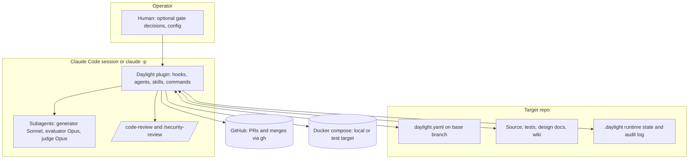
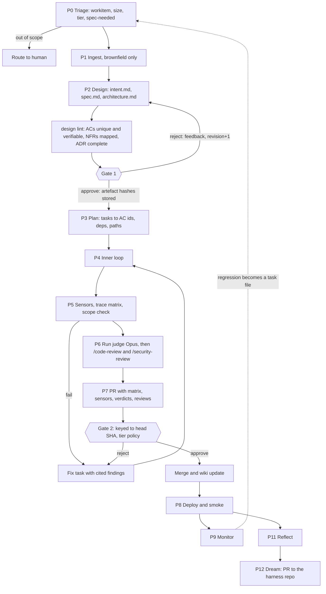
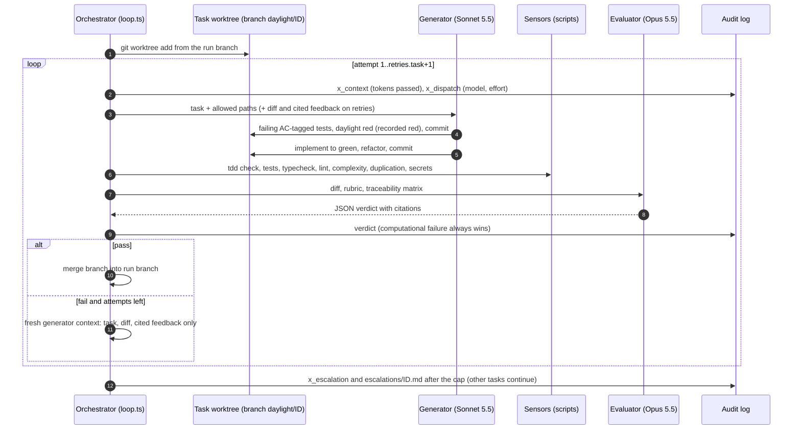
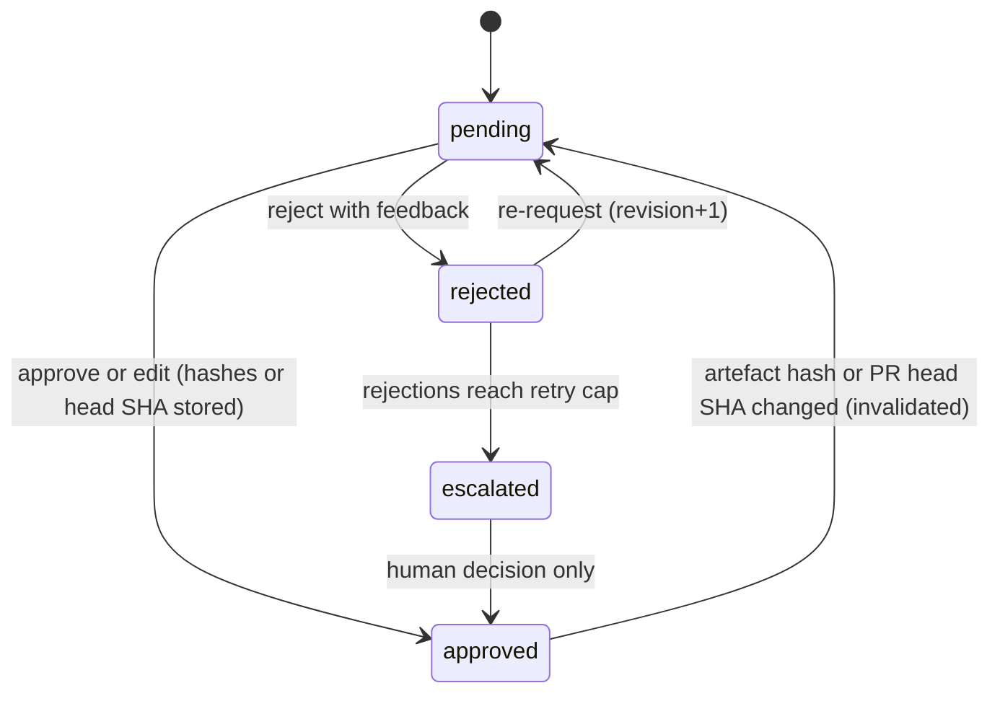
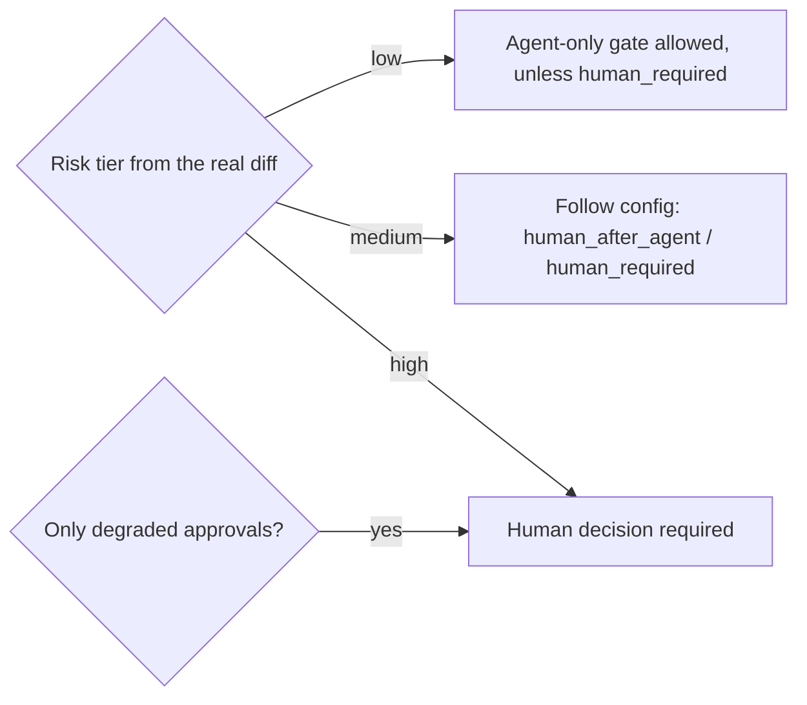
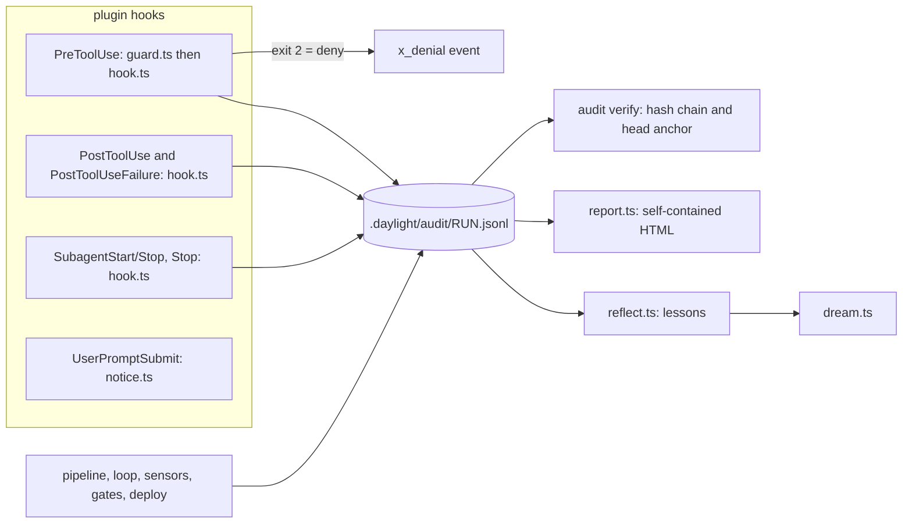
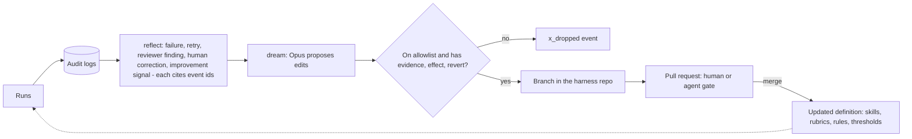

# Daylight architecture

How Daylight is designed and built. For usage see [README.md](README.md); for the approved design documents see [docs/design/](docs/design/) (intent, spec with 112 acceptance criteria, architecture with ADR-001..018, build plan) and [docs/adr/ADR-019-build-deviations.md](docs/adr/ADR-019-build-deviations.md) for what changed during the build.

## 1. Principles
1. **Reuse, do not reinvent.** Claude Code supplies subagents, hooks, skills, plugins, headless mode, `/code-review` and `/security-review`; git supplies worktrees; docker compose supplies deploy. Custom code is plumbing only, and every source file starts with a `Reuses:` header enforced by `daylight ledger --check` (see [docs/reuse-ledger.md](docs/reuse-ledger.md)).
2. **Lights on, not dark.** One append-only, hash-chained event log records every action; one HTML report renders it.
3. **Generator and evaluator on every task.** Sonnet 5.5 generates; Opus 5.5 grades against an explicit rubric with cited evidence. Computational sensors decide pass/fail; models never overrule them.
4. **Every phase works headless.** Code Mode is an interactive optimisation only; state lives in files, not in the session.
5. **Judges are out of reach of what they judge.** Config, rubrics and deny-lists come from the base branch; the generator cannot edit them.

### 1.1 Why Daylight is a Lights-On Factory
In contrast to a *dark factory* (a black box that generates and ships code with no visibility or steering), Daylight is a **lights-on software factory**: autonomy is bounded by visible specs, deterministic evidence, independent cited evaluation, a tamper-evident audit trail, and explicit human decision points.

| Lights-on pillar | Concrete mechanism in Daylight |
|---|---|
| **Human gates by default, autonomous by choice** | Defaults to **2 human gates** — Gate 1 (Design: `intent.md`, `spec.md`, `architecture.md`) and Gate 2 (PR: reviewed diff + traceability matrix). Even in 0-gate (`--agents`) or `/daylight:goal` mode, hitting a retry cap or plan/harness failure escalates loudly to `.daylight/escalations/<task>.md` with cited `file:line` evidence (and seeds `--resume` with those findings). |
| **Full observability** | Every tool call, subagent dispatch, model, token count, cost, sensor result, verdict, and gate decision is written to a **SHA-256 hash-chained audit ledger** (`.daylight/audit/<run>.jsonl`, verified via `daylight ledger --check`) and rendered into `summary.json` + an offline HTML report. |
| **Deterministic evidence overrides LLM opinion** | Every AC is traced to a passing test (`trace`) and proven **red-at-base** (`tdd.ts`). Deterministic sensors (`pytest` / `npm test` / `cargo test`, complexity, duplication, secrets, layers) can never be overridden by an evaluator LLM (ADR-002). Delivery is proven by actually running Docker + smoke tests (`delivery.ts`), not by an LLM reading a `Dockerfile`. |
| **Separation of powers & hard guardrails** | Generator (Sonnet) ≠ Evaluator (Opus) ≠ Run Judge (Opus); uncited fails are rejected as inconclusive. `PreToolUse` hooks (`guard.ts`) block the generator from editing rubrics/specs/config, block pushes to `main`, block real deploys, and deny credential paths. |
| **Lights stay on outside factory runs** | Each run updates `docs/wiki/` (the "why-trail") and records machine-readable lessons (`reflect.ts`). **`/daylight:mode on`** (vibe mode) keeps `rules/guides.md` injected on every prompt (`notice.ts`) and fast sensors blocking on every session stop (`vibe.ts`) during interactive coding. **`/daylight:init`** scaffolds any TypeScript, Python 3.14, or Rust repo in one command. |

## 2. System context

## 3. Phases and the pipeline

Each box is one or more CLI commands. `src/pipeline.ts` (`daylight run`) is only the sequencer; every phase is also runnable on its own, which is how the tests exercise them.

### Phase table: Code Mode capable vs headless
Machine-readable copy: `plugin/config/phases.json`; the headless rows are run through a real `claude -p` without Code Mode by test AC-87.

| Phase | Mode | Notes |
|---|---|---|
| P0 doctor, triage, triggers | headless | scheduled triggers run with no human |
| P1 ingest, P2 design, gates (human), P3 plan, P4 inner loop | Code Mode capable | batch reads, sensor runs, multi-file edits when interactive; same skills run under `claude -p` |
| P5 sensors, P6 judge and reviews, P7 PR, P8 deploy, P9 monitor, P10 wiki, P11 reflect, P12 dream, audit | headless | plain scripts and `claude -p` |

## 4. The inner loop (generator and evaluator)

Key rules (all unit-tested):
- **Effort** follows task size and risk: small low, default medium, risky or attempt 3+ high; the choice is logged.
- **Fresh minimal context** on retry: task, diff and cited feedback only; passed-context size is logged against `context.budget_tokens`.
- **Uncited fail is inconclusive** and cannot block; a failing required sensor makes the verdict fail regardless of the evaluator (ADR-002).
- **Parallelism**: tasks with no dependency edge run as concurrent subagents in separate worktrees; overlapping windows show in the log.
- **Degraded fallback**: if the evaluator model is unavailable the loop retries on `models.evaluator_fallback`, logs `degraded_evaluator`, marks verdicts degraded and writes a notice that the next prompt displays.

## 5. Gate state machine

Gate 1 subject = SHA-256 of intent, spec and architecture. Gate 2 subject = PR head SHA. `gate satisfied` evaluates the tier policy:

## 6. Audit, hooks and guards

- **REPL-aware** (Code Mode): `REPL` calls are logged with the full JavaScript and `stdout/stderr/result`; inner calls link via `parent_id` (verified in a live session, see [docs/spikes.md](docs/spikes.md); inner calls did not fire their own hooks, so the REPL record is the audit of the batch). `audit reconstruct` rebuilds a batch from the log.
- **Hash chain**: each line carries the SHA-256 of the previous line; a `.head` file anchors the last hash and count, so edits, removals and tail truncation are detected.
- **Redaction** of secret patterns happens before any write.
- **Guards** (all PreToolUse, none sandbox-dependent): credential paths, push to default branch, foreign deploy targets, and generator edits to rubric / spec / sensor config / `daylight.yaml`.
- `DAYLIGHT_AUDIT_ROOT` makes hooks fired inside task worktrees write to the run's main log.

## 7. Module map

| Concern | Files (plugin/src) | Reuses |
|---|---|---|
| Config | `config.ts`, `../config/*.json` | ajv, yaml |
| Setup and reuse | `doctor.ts`, `ledger.ts` | Claude Code settings |
| Audit | `lib/events.ts`, `audit.ts`, `hook.ts`, `notice.ts`, `metrics.ts`, `report.ts` | hooks protocol, node crypto |
| Intake and risk | `workitem.ts`, `triage.ts`, `tiers.ts`, `guard.ts` | gh, hook protocol |
| Design and gates | `design.ts`, `gate.ts`, `state.ts` | Superpowers brainstorming, `claude -p` approver |
| Inner loop | `plan.ts`, `loop.ts`, `worktree.ts`, `tdd.ts`, `verdict.ts` | subagents, git worktrees |
| Verification | `sensors.ts`, `trace.ts`, `review.ts`, `judge.ts` | project test/tsc/lint commands, `/code-review`, `/security-review` |
| Delivery | `pr.ts`, `deploy.ts`, `pipeline.ts` | gh, docker compose |
| Knowledge | `wiki.ts`, `ingest.ts` | git, README and tool configs as evidence |
| Improvement | `reflect.ts`, `dream.ts`, `replay.ts`, `definition.ts`, `benchmark.ts` | `claude -p` JSON usage, git, cron |
| Entry | `cli.ts`, `../bin/daylight` | node |

## 8. Sensors and traceability
Fast sensors run after every task by script (never by asking the model): configured commands (tests, typecheck, lint), plus built-in TypeScript analysers for cyclomatic complexity, duplication (token-shingle similarity), dependency-layer rules, offline vulnerable-version list and secrets. Output is rewritten into short fix-oriented lines ("file:line rule -> suggestion") capped at `sensors.output_line_cap`. Slow sensors (mutation, full suites) run detached with status files, so no single wait nears Code Mode's 10-minute limit. The **traceability matrix** parses the test runner output (TAP or spec style) and maps `AC-n` in test names to results; an unmapped or failing AC fails the check, and the evaluator may judge only whether mapped tests really assert the AC.

## 9. Self-improvement loop

The Daylight definition (daylight.yaml, rubrics, deny-lists, skills) is versioned code; `daylight definition diff <ref> <ref>` lists what changed, and `daylight replay` re-runs fixture specs under two configurations to compare cost against quality.

## 10. Key decisions
| ADR | Decision |
|---|---|
| 001, 015 | Compose existing plugins; reuse by install, replicate with attribution only when impractical |
| 002 | Evaluator verdicts cite evidence; computational sensors decide |
| 003, 010 | Every phase headless; run state in files, not the session |
| 004 | Audit through hooks, REPL-aware, hash-chained |
| 005, 017 | Gate and sensor config read from the base branch; the definition is code |
| 006 | Gate 1 human and Gate 2 agent-then-human by default; both configurable |
| 009 | TypeScript only in v1 |
| 012, 013 | Triage, risk tiers, whole-run judge, computational scope check |
| 016 | Opus only at judgments; loud bounded fallback to Sonnet |
| 019 | Build-time deviations (read this one for what differs from the original design) |

## 11. How it was built
Thirteen increments, one commit each on `factory/build`, strict TDD (a failing test, named by AC id, before every implementation): spikes, plugin skeleton and config, audit log, triage and tiers, outer loop and Gate 1, inner loop, sensors and traceability, PR and Gate 2, report, wiki, ingest, deploy and monitor, reflection and dream, then efficiency, validation and the pipeline. Real runs against sample repos found harness bugs that were fixed test-first (test-output parsing, scope baseline, planner rules) and exposed gaps that became features (the Gate 2 reject-then-fix loop); see [docs/demos/README.md](docs/demos/README.md). Test strategy: unit and fixture tests with stubs for `claude`, `gh`, `docker`, plus a real-model test (AC-87) and the end-to-end demos.
