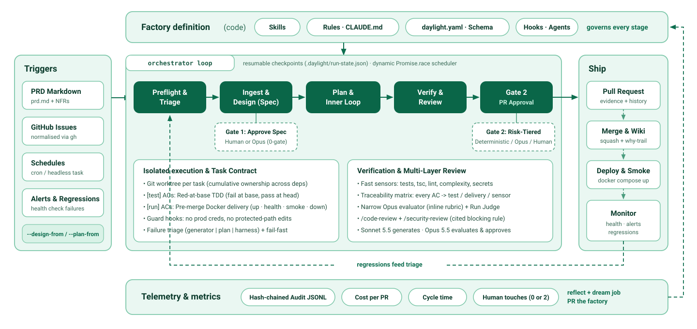

# Daylight — Lights-On Software Factory for Claude Code

Daylight is a local Claude Code plugin that takes a PRD (or GitHub issue / scheduled task) and delivers reviewed, tested, Docker-deployed code with **0 human gates** (fully unattended) or **2 human gates** (design + PR approval). Every tool call, model, token count, sensor result, verdict, and gate decision is written to a hash-chained audit log and HTML report.



## Requirements
- **Node.js 24+** (runs TypeScript directly via type stripping)
- **Claude Code** (`claude` CLI logged in with `claude-sonnet-5-5` and `claude-opus-5-5`)
- **git** and **Docker** (for local compose deploy & smoke verification)
- **Supported stacks:** TypeScript, Python 3.14 (`uv` + `pytest`), and Rust (`cargo`)

## Quick Start: Scaffold & Run

### 1. Clone and install plugin dependencies (one-time)
```bash
git clone https://github.com/cwijayasundara/daylight-factory.git
cd daylight-factory/plugin && npm ci
```

### 2. Launch Claude Code in your target folder (no marketplace needed)
```bash
cd /path/to/your-target-repo
claude --plugin-dir /path/to/daylight-factory/plugin
```

### 3. Scaffold Daylight in the target folder
Inside Claude Code, run:
```text
/daylight:init --stack python --gates 0
```
*Options:* `--stack ts|python|rust` (auto-detected on existing repos) and `--gates 0|2` (`0` = fully unattended, `2` = human approves design & PR).

This initializes git if needed, copies factory artefacts (`skills/`, `rules/`, `config/`) to `.daylight/factory/`, creates `daylight.yaml` (or runs `ingest` on brownfield repos), and writes a starter `prd.md`.

### 4. Edit `prd.md`, commit the baseline, and run the factory
```bash
git add -A && git commit -m "initial baseline"
```
Then inside Claude Code:
```text
/daylight:run prd.md --agents
```
*(Omit `--agents` for 2-human-gate mode.)*

`/daylight:run` drives **all phases itself** — triage → design → Gate 1 → plan → TDD inner loop (generator + evaluator) → sensors → judge → PR → Gate 2 → deploy → smoke → wiki — and knows how to handle every exit: it presents design/PR artefacts for your decision at human gates (`daylight gate decide ...`), auto-resumes with `--resume` after tool timeouts, and reads `.daylight/escalations/` on failures instead of improvising the phases.

## Command Reference
| Command | Purpose |
|---|---|
| `/daylight:init [--stack ts\|python\|rust] [--gates 0\|2]` | Scaffold the factory into the target repo (`.daylight/factory/`, `daylight.yaml`, starter `prd.md`) |
| `/daylight:run <prd.md> [--agents] [--resume]` | Run the full factory; self-drives gates, resumes after timeouts/escalations |
| `/daylight:mode on\|off\|status` | Vibe mode: guides + sensors enforced on every edit, not just factory runs |
| `daylight doctor` | Verify your environment (node, claude, docker, git) |
| `daylight config --resolved` | Show the merged `daylight.yaml` configuration |
| `daylight gate present \| decide` | Inspect/approve a human gate (design or PR) |
| `daylight ledger --check` | Verify the hash-chained audit log |

## Vibe Mode: the harness on every edit
Run `/daylight:mode on` (or `daylight mode on`) to keep the factory enforcing even when you vibe-code outside `/daylight:run`:
- **Guidelines** from `rules/guides.md` (TDD, SOLID, SRP) are injected into every prompt.
- **Fast sensors** (`secrets`, `complexity`, `duplication`) run on every session stop; failures are fed back so the session must fix them before it can stop.
- The always-on guards still apply: no pushes to the default branch, no real deploys, no credential-path access, and every tool call is audited to the ledger.

Turn it off with `/daylight:mode off`; check state with `/daylight:mode status`. Opt into slower sensors with `/daylight:mode on --sensors secrets,complexity,duplication,tests`.

## Headless CLI, Resume & Frozen Runs

You can also run the factory directly from your terminal (same engine as `/daylight:run`):

```bash
# 0-gate unattended run
DAYLIGHT_RUN=run1 node /path/to/daylight-factory/plugin/src/cli.ts run prd.md --agents --summary-out summary.json

# 2-human-gate run
DAYLIGHT_RUN=run1 node /path/to/daylight-factory/plugin/src/cli.ts run prd.md --summary-out summary.json

# Resume an interrupted or escalated run from its last checkpoint
DAYLIGHT_RUN=run1 node /path/to/daylight-factory/plugin/src/cli.ts run prd.md --agents --resume --summary-out summary.json

# Frozen-plan run (skip design/plan model calls; test the inner loop cheaply)
DAYLIGHT_RUN=run1 node /path/to/daylight-factory/plugin/src/cli.ts run prd.md --agents --design-from docs/design --plan-from .daylight/plan.json --stop-after inner
```

> **Tip:** Always run from a fresh throwaway branch at your baseline commit — runs squash-merge into their base branch, and preflight refuses a base that already contains the feature.

## Testing & Further Reading
- Run plugin tests: `cd plugin && npm run typecheck && npm test`
- Architecture & internals: [ARCHITECTURE.md](ARCHITECTURE.md)
- Reuse ledger: [docs/reuse-ledger.md](docs/reuse-ledger.md)
- Daylight vs Rig comparison: [docs/daylight-vs-rig-comparison.html](docs/daylight-vs-rig-comparison.html)
